# IT Asset & Inventory Management + ITERA

Aplikasi internal PT Adhi Kartiko Pratama untuk **mengelola aset dan stok IT** (laptop, PC, monitor, aksesori, consumable, komponen, lisensi, IP perangkat) dan **menerima request ke Tim IT** lewat modul **ITERA** (System Requisition). Keduanya satu aplikasi, satu login (NIK), dan datanya saling terhubung.

- **Teknologi:** Laravel 13, Filament 5, Livewire, PostgreSQL 16, PHP 8.3, Docker.
- **Bahasa & tampilan:** Bahasa Indonesia, mode terang saja.
- **Dua pintu masuk:**
  - `/admin` : panel **IT Asset** (Filament) untuk Admin dan Staff IT.
  - `/requisition` : **ITERA** (form request, approval, peminjaman). Karyawan biasa langsung diarahkan ke `/requisition/requests/create`.

---

## 1. Peran dan hak akses

| Peran | Bisa apa |
|---|---|
| **Admin** | Semua: master data (kategori, lokasi, vendor, department), Pengaturan, hapus data, persetujuan disposal, approval request. |
| **Staff IT** | Mengelola inventaris dan transaksi, memproses request. Tidak bisa Pengaturan, dan tidak bisa menambah master data. |
| **User** (karyawan) | Mengirim request di ITERA, melihat **Barang Saya** (aset yang dipegang), dan melihat BAST miliknya. |

Login memakai **NIK** dan password. Peran ITERA diturunkan dari peran IT Asset (Admin → super_admin, Staff IT → admin, User → user).

---

## 2. Alur utama

> Setiap alur tersedia sebagai **gambar SVG** (folder [`docs/alur/`](docs/alur/), bisa dibuka langsung di browser atau disisipkan ke dokumen/presentasi). Versi teks Mermaid dilipat di bawah tiap gambar.

### 2.1 Siklus hidup aset

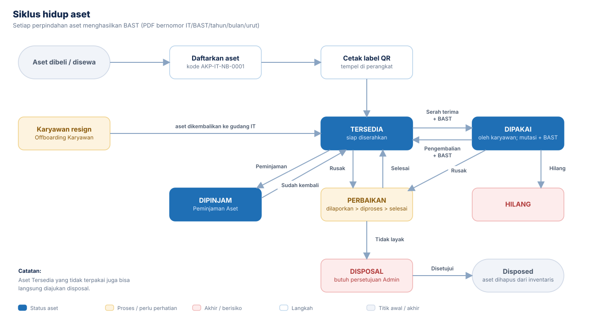

<details>
<summary>Versi teks (Mermaid) untuk diagram di atas</summary>

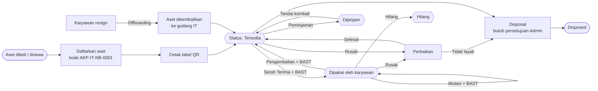

</details>

Setiap perpindahan aset menghasilkan **BAST** (Berita Acara Serah Terima) berformat PDF dengan nomor `IT/BAST/2026/11/0053` dan tersimpan di arsip.

### 2.2 Stok barang pendukung (Accessories, Consumable, Komponen)

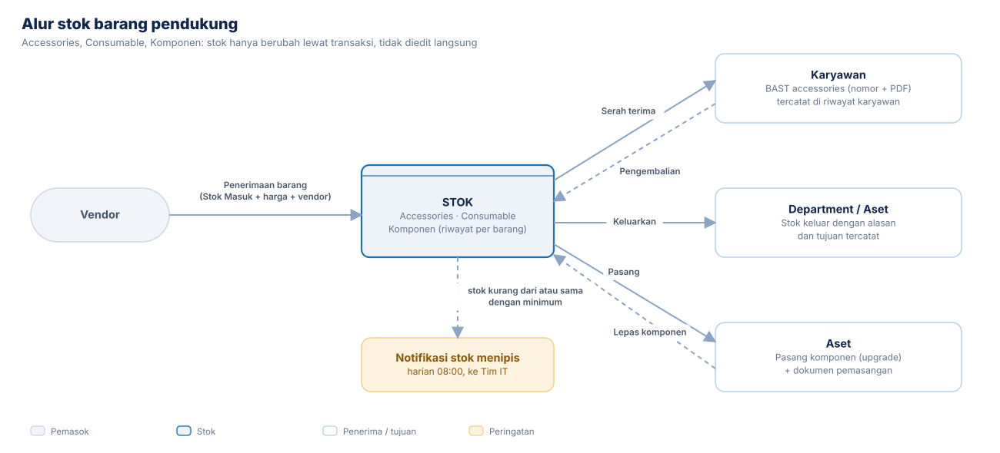

<details>
<summary>Versi teks (Mermaid) untuk diagram di atas</summary>

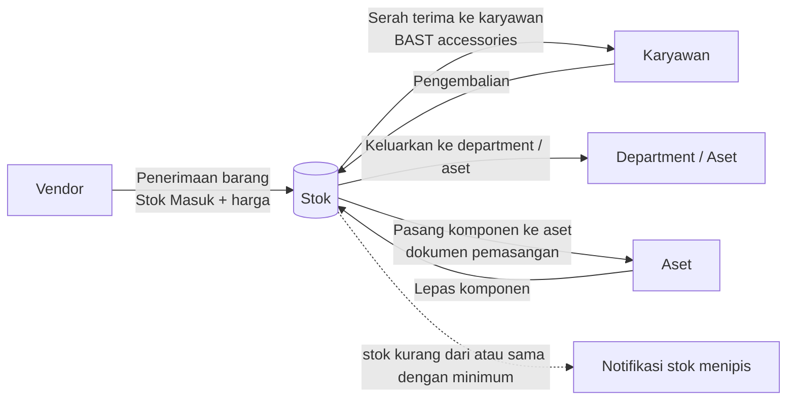

</details>

Aturan penting: stok **hanya berubah lewat transaksi** (masuk, keluar, kembali, pasang, lepas, penyesuaian), bukan diedit langsung. Setiap transaksi tercatat di riwayat stok per jenis barang.

### 2.3 Request ITERA (dari karyawan sampai selesai)

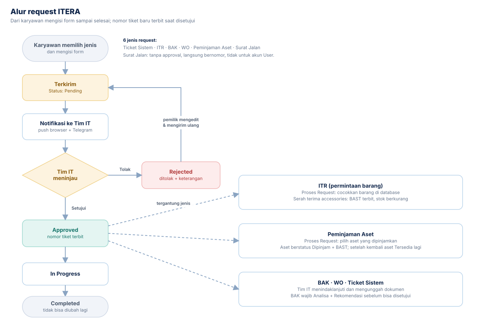

<details>
<summary>Versi teks (Mermaid) untuk diagram di atas</summary>

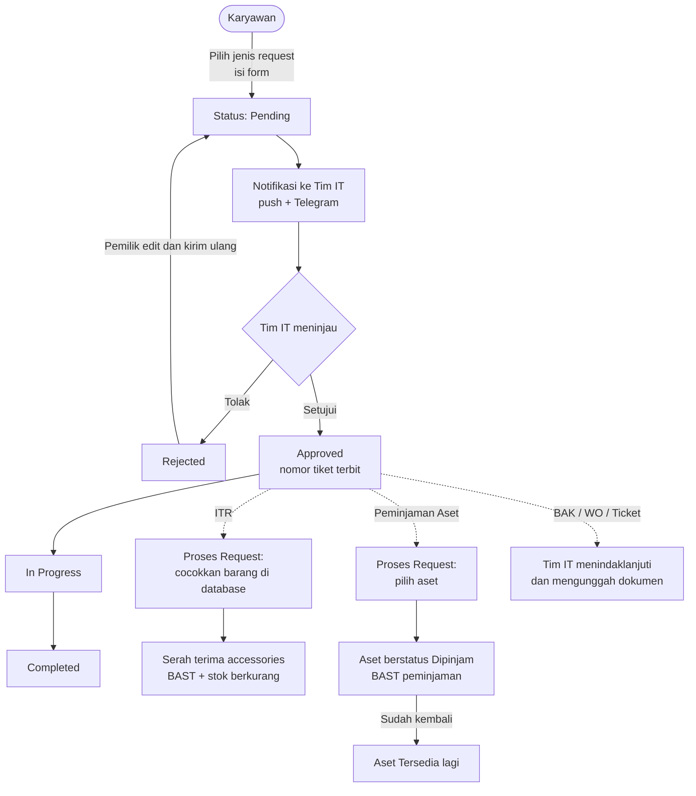

</details>

Jenis request dan nomor tiketnya:

| Jenis | Kode tiket | Perlu approval? | Foto bukti |
|---|---|---|---|
| Ticket Sistem (laporan kendala) | `AKP-TS` | Ya | Opsional |
| ITR (permintaan barang) | `AKP-ITR` | Ya | Opsional |
| BAK (berita acara kerusakan) | `AKP-BAK` | Ya, wajib Analisa dan Rekomendasi | **Wajib** |
| WO (work order) | `AKP-WO` | Ya | Opsional |
| Peminjaman Aset | `AKP-PJ` | Ya | Opsional |
| Surat Jalan (bukan untuk akun User) | `AKP-SJ` | Tidak, langsung bernomor | **Wajib** |

Format nomor: `AKP-ITR` + tahun-bulan (yymm) + urut 3 digit, mis. `AKP-ITR2611005`. Nomor terbit **saat disetujui** dan tidak dipakai ulang walau request dihapus.

### 2.4 Karyawan baru dan rencana kedatangan

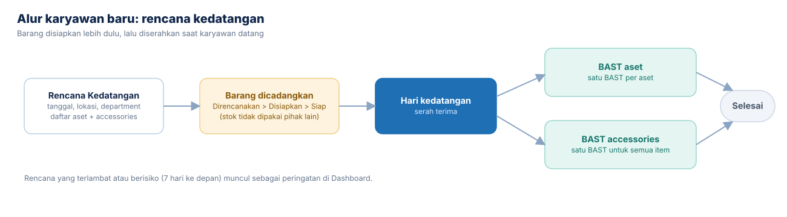

<details>
<summary>Versi teks (Mermaid) untuk diagram di atas</summary>

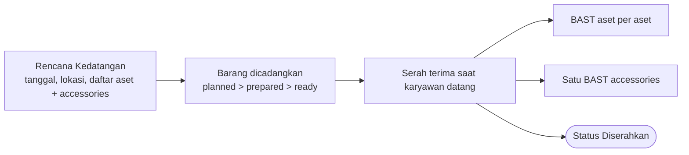

</details>

### 2.5 Scan QR dan label

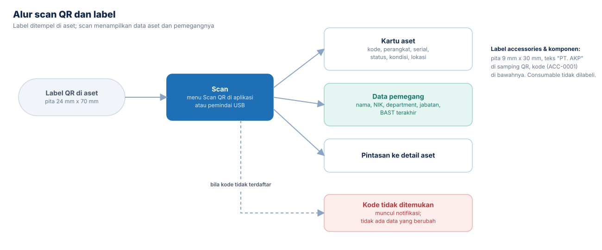

<details>
<summary>Versi teks (Mermaid) untuk diagram di atas</summary>

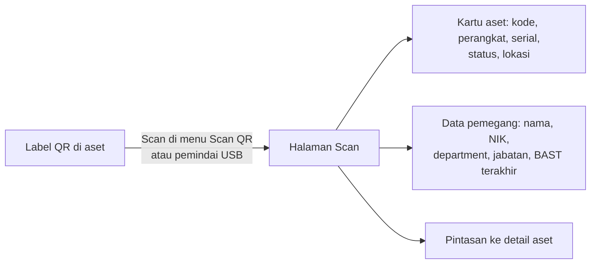

</details>

Label aset: pita 24 mm, panjang 70 mm (harus sama dengan setelan *Length* di driver Brother PT-D610BT). Label accessories dan komponen: pita 9 mm, panjang 30 mm, teks "PT. AKP" di samping QR dan kode (mis. `ACC-0001`) di bawahnya. Consumable tidak dilabeli.

---

## 3. Peta modul

| Kelompok | Menu | Fungsi | Tabel utama |
|---|---|---|---|
| Umum | Dashboard | Ringkasan aset, nilai, stok menipis, garansi, lisensi, CAPEX/OPEX, aset per department | (membaca semua) |
| Umum | Barang Saya | Aset yang dipegang user yang login, lapor kerusakan | `assets` |
| Inventaris | Scan QR, Aset, Aset Sewa | Daftar dan detail aset, kontrak sewa, penyusutan | `assets`, `rental_contracts` |
| Inventaris | Accessories, Consumable, Komponen | Stok barang pendukung | `accessories`, `consumables`, `components` |
| Inventaris | Lisensi & Langganan | Lisensi, seat, masa berlaku | `licenses`, `license_seats` |
| Inventaris | List IP Device | Daftar IP perangkat jaringan dengan kredensial terenkripsi | `ip_addresses` |
| Inventaris | Cetak Label, Import Aset | Label QR, impor massal dari CSV | `assets` |
| Transaksi | Rencana Kedatangan | Persiapan aset karyawan baru | `arrival_plans`, `arrival_plan_items` |
| Transaksi | Serah Terima Aset (BAST) | Riwayat serah terima, mutasi, pengembalian | `asset_assignments`, `asset_bast_files` |
| Transaksi | Penerimaan Barang, Riwayat Stok | Barang masuk dari vendor dan semua mutasi stok | `stock_receipts`, `stock_movements` |
| Transaksi | Perbaikan, Disposal | Servis aset dan penghapusan aset | `repairs`, `disposals` |
| Transaksi | Stock Opname, Offboarding | Pengecekan fisik dan serah terima saat resign | `stock_opnames`, `stock_opname_items` |
| Master Data | Kategori, Merek, Model, Department, Lokasi, Vendor, Karyawan | Data acuan (hanya Admin yang mengubah) | tabel masing-masing |
| Master Data | Pengaturan | Awalan kode, kop BAST, umur ekonomis, kolom spesifikasi | `settings` |
| Laporan | Laporan | Ekspor Excel dan PDF | (membaca) |
| ITERA | Pilih Jenis Request, History, Dashboard ITERA, Peminjaman | Form dan approval request | `i_t_requests`, `request_item_links` |

---

## 4. Penomoran dan kode

| Objek | Format | Contoh | Aturan |
|---|---|---|---|
| Kode aset | `AKP-IT-{KATEGORI}-{4 digit}` | `AKP-IT-NB-0018` | Laptop memakai `NB`. Awalan dan jumlah digit bisa diatur (`ASSET_TAG_PREFIX`, `ASSET_TAG_DIGITS`). |
| Nomor BAST aset | `IT/BAST/{tahun}/{bulan}/{urut 4 digit}` | `IT/BAST/2026/11/0053` | Urut per bulan. PDF: `bast/IT-BAST-2026-11-0053.pdf`. |
| BAST accessories | `NNN/IT/KODE/AKP/ROMAWI/TAHUN` | | Format terpisah dari BAST aset. |
| Kode accessories / consumable / komponen | `ACC-0001` / `CSM-0001` / `CMP-0001` | | Awalan bisa diganti di Pengaturan. |
| Tiket ITERA | `AKP-{JENIS}{yymm}{urut}` | `AKP-ITR2611005` | Lihat bagian 2.3. |

Kode aset yang pernah berganti disimpan di riwayat (`asset_tag_aliases`) supaya label lama tetap bisa di-scan.

---

## 5. Struktur database (relasi inti)

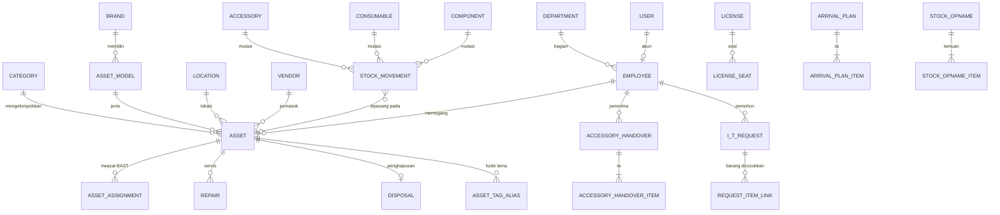

Status penting:
- **Aset:** `available` (Tersedia), `deployed` (Dipakai), `repair`, `borrowed` (Dipinjam), `lost`, `disposed`, `returned` (kembali ke vendor, untuk aset sewa).
- **Serah terima:** `checkout` (Serah Terima), `checkin` (Pengembalian), `transfer` (Mutasi).
- **Mutasi stok:** `in`, `out`, `return`, `install`, `uninstall`, `adjust`.
- **Perbaikan:** `reported` > `in_progress` > `done`. **Disposal:** `pending` > `approved` / `rejected`. **Opname:** `running` > `finished`.
- **Request ITERA:** `Pending`, `Approved`, `Rejected`, `In Progress`, `Completed` (status Completed tidak bisa diubah lagi).

---

## 6. Struktur kode

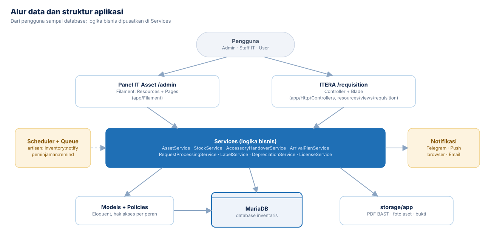

```
inventaris-it/
├── docker-compose.yml          # app (php-apache, port 8080), scheduler, queue, db (PostgreSQL)
├── backup-*.sql, backup-*/     # cadangan sebelum perubahan data (jangan dihapus sembarangan)
└── src/                        # aplikasi Laravel
    ├── app/
    │   ├── Models/             # Eloquent: Asset, Employee, StockMovement, ITRequest, ...
    │   ├── Services/           # logika bisnis (satu tempat untuk aturan)
    │   │   ├── AssetService            serah terima, mutasi, pengembalian aset + BAST
    │   │   ├── StockService            semua mutasi stok
    │   │   ├── AccessoryHandoverService  serah terima accessories/consumable/komponen
    │   │   ├── ArrivalPlanService      rencana kedatangan
    │   │   ├── RequestProcessingService  request ITERA -> data IT Asset (pinjam aset, dll.)
    │   │   ├── LabelService            label QR dan pencarian hasil scan
    │   │   ├── DepreciationService, SpendService   penyusutan, CAPEX/OPEX
    │   │   └── TelegramNotifier, NotificationService, WeeklyReportService
    │   ├── Filament/
    │   │   ├── Resources/      # satu folder per modul: tabel, form, halaman (Assets, Accessories, ...)
    │   │   ├── Pages/          # halaman khusus: Dashboard, Scan, Pengaturan, Proses Request, ...
    │   │   └── Support/        # komponen bersama (toolbar stok, tombol aksi, tambah-cepat dropdown)
    │   ├── Http/Controllers/   # ITERA (RequestController, PeminjamanController), laporan, label, BAST
    │   ├── Support/            # dokumen BAST, penomoran kode, branding
    │   ├── Reports/            # isi laporan Excel/PDF
    │   ├── Policies/           # hak akses per modul
    │   └── Console/Commands/   # perintah artisan (bagian 8)
    ├── routes/
    │   ├── web.php             # BAST, label, laporan, alamat pendek QR
    │   ├── requisition.php     # semua rute ITERA (/requisition/...)
    │   └── console.php         # jadwal otomatis
    ├── resources/views/
    │   ├── filament/           # tampilan halaman Filament
    │   ├── requisition/        # tampilan ITERA (kartu jenis request, form, dashboard)
    │   └── pdf/                # templat PDF (BAST, label, request)
    ├── config/                 # asset_tag.php, labels.php, depreciation.php, ...
    ├── database/
    │   ├── migrations/         # selalu aditif (tidak menghapus data)
    │   └── seeders/            # DatabaseSeeder (peran), DemoDataSeeder (data uji)
    ├── public/css/             # akp-theme.css (panel), requisition-theme.css (ITERA)
    └── tests/
        ├── Qa/                 # uji fitur IT Asset (Qa01 ... Qa58)
        └── Requisition/        # uji ITERA
```

---

## 7. Menjalankan

```bash
# dari folder inventaris-it/
docker compose up -d                       # app (8080), scheduler, queue, db

# SELALU jalankan artisan sebagai user "application" (bukan root)
docker compose exec -T -u application app php artisan migrate --force
docker compose exec -T -u application app php artisan optimize:clear
```

Buka `http://<IP-server>:8080/admin`. Database `inventaris` adalah data asli (`APP_ENV=production`, jadi migrasi butuh `--force`). Database `inventaris_test` khusus untuk tes dan **dikosongkan setiap tes dijalankan**.

### Konfigurasi penting (`.env`)

| Variabel | Fungsi | Bawaan |
|---|---|---|
| `ASSET_TAG_PREFIX`, `ASSET_TAG_DIGITS` | Awalan dan jumlah digit kode aset | `AKP-IT`, `4` |
| `LABEL_TAPE_MM`, `LABEL_LENGTH_MM` | Ukuran label aset (harus sama dengan driver printer) | `24`, `70` |
| `LABEL_OTHER_TAPE_MM`, `LABEL_OTHER_LENGTH_MM`, `LABEL_OTHER_COMPANY` | Label accessories/komponen | `9`, `30`, `PT. AKP` |
| `LABEL_QR_MODE` | Isi QR: `code` (kode saja) atau `url` (alamat `/s/KODE`, bisa discan kamera HP) | `code` |
| `TELEGRAM_BOT_TOKEN`, `TELEGRAM_ADMIN_CHAT_ID` | Notifikasi request ke grup Telegram Tim IT | kosong |
| `VAPID_*` | Push notification browser | kosong |
| `MAIL_MAILER` | Email (BAST, akun baru) | `log` |

---

## 8. Perintah artisan dan jadwal otomatis

| Perintah | Fungsi |
|---|---|
| `inventory:audit` | Periksa konsistensi data antar fitur (stok, serah terima, lisensi, perbaikan, dokumen). Jalankan berkala. |
| `inventory:notify {daily / weekly / monthly}` | Notifikasi stok, lisensi, garansi, resign, perbaikan. |
| `peminjaman:remind` | Pengingat peminjaman aset yang jatuh tempo. |
| `assets:renumber-tags [--dry-run]` | Rapikan kode aset ke format sekarang (kode lama masuk riwayat). |
| `bast:renumber-assets [--dry-run]` | Ubah nomor BAST aset ke format `IT/BAST/...` (berkas lama dicadangkan). |
| `bast:regenerate NOMOR... [--dry-run]` | Buat ulang PDF BAST yang rusak atau tertimpa. |
| `bast:refresh-equipment [--dry-run]` | Perbarui kelengkapan BAST dari komponen terpasang. |
| `components:backfill-install-documents [--dry-run]` | Dokumen susulan pemasangan komponen lama. |
| `labels:sample` | Buat PDF contoh label untuk cek visual. |

Jadwal otomatis (`routes/console.php`): notifikasi harian 08:00, mingguan Senin 08:00, bulanan tanggal 1 pukul 08:00, dan pengingat peminjaman tiap 30 menit.

Perintah yang mengubah data punya opsi `--dry-run` : **selalu jalankan dulu**.

---

## 9. Tes dan kualitas

```bash
docker compose exec -T -u application app php artisan test
docker compose exec -T -u application app php artisan test --filter=Qa56     # satu kelompok
```

- `tests/Qa` menguji fitur IT Asset; `tests/Requisition` menguji ITERA.
- `Qa56` : alur lintas modul (ITR > BAST > stok, Peminjaman > aset) dan ketahanan input form.
- `Qa57` : sapuan otomatis semua halaman daftar (urut, cari, filter, tombol).
- `Qa58` : angka Dashboard dicocokkan dengan data.
- Tes berjalan di `inventaris_test` dan berkas diisolasi, sehingga **data asli dan PDF BAST asli tidak tersentuh**.

---

## 10. Aturan kerja

1. **Perubahan database selalu aditif** dan dibuat cadangan (`pg_dump`) sebelum dijalankan di data asli.
2. **Jangan menjalankan perintah artisan sebagai root** (menimbulkan berkas milik root di `storage`). Cek: `find storage bootstrap/cache -user root` harus kosong.
3. **Tambah master data langsung dari form** lewat tombol `+` di dropdown (hanya Admin). Satuan consumable bisa ditambah oleh yang membuat barang.
4. Tampilan **mode terang saja**; bahasa Indonesia.
5. `.claude/` dan `validasi-asset-laptop.csv` tidak ikut di-commit.
6. Halaman ITERA **tidak memuat Alpine.js**: komponen interaktif di sana memakai JavaScript biasa (lihat `requisition/partials/account-menu.blade.php`).
7. Sebelum rilis: `php artisan test` harus hijau dan `inventory:audit` tidak melaporkan pelanggaran baru.
